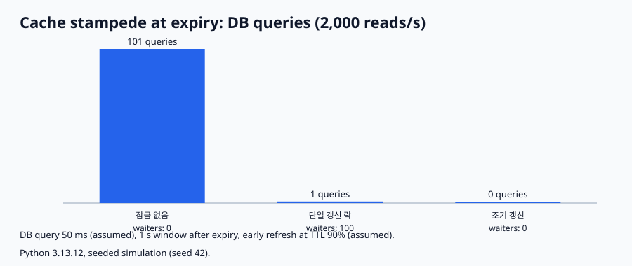

# 049. 캐시 스탬피드: 만료 순간 동시 요청이 DB로 몰리는 수와 락 대기 vs 조기 갱신

> 면접 질문: 인기 캐시 키가 만료되는 순간 DB가 한꺼번에 무너지지 않게 하려면 어떻게 하나요? 초당 2,000건 읽기에서 잠금이 없으면 만료 구간에 DB 조회 101번, 갱신 락 하나면 1번(락을 기다리는 요청 100건), TTL 90% 지점에서 미리 갱신하면 만료 구간에 0번이다.

## 문제

인기 키 하나가 만료되는 순간, 값이 없는 동안 들어온 요청이 모두 DB를 조회하면 같은 쿼리가 동시에 몰린다. 이를 캐시 스탬피드(thundering herd)라고 한다. 막는 방법은 세 가지다. 하나는 잠금 없이 두는 것, 하나는 갱신 락을 잡은 요청만 DB에 가고 나머지는 기다리게 하는 것, 마지막은 만료 전에 미리 갱신하는 것이다. 이 실험은 만료 뒤 1초 구간의 DB 조회 수, 락을 기다린 요청 수, 요청 지연 p99를 센다.

## 실험

- 키 하나, TTL 만료 시각을 0 ms로 둔다. 만료 뒤 1초 동안 읽기 요청을 포아송 과정으로 넣는다(초당 100, 500, 2,000건, 시드 42).
- DB 한 번 조회는 50 ms로 고정(가정). DB 동시 처리 한도나 큐 대기는 넣지 않았다.
- 잠금 없음: 값이 없는 동안 들어온 요청마다 DB를 조회한다.
- 단일 갱신 락: 값이 없을 때 첫 요청만 DB를 조회하고, 나머지는 그 결과를 기다린다. 락을 잡은 프로세스가 죽는 경우는 넣지 않았다.
- 조기 갱신: TTL 60초의 90% 지점(만료 6초 전)에 첫 요청이 갱신을 시작한다고 가정한다. 갱신 조회 1번은 만료 전에 나가므로 만료 구간 DB 조회는 0번이다. 요청이 한 번도 안 들어오면 갱신이 일어나지 않는 경우는 이 시뮬레이션에 넣지 않았다.
- 표준 라이브러리만 사용. 실제 DB 지연과 락 타임아웃은 실제 환경에서 다시 재야 한다.

```bash
python3 main.py              # 표 출력
python3 main.py --write-svg  # result.svg 다시 그리기
```

## 결과



초당 2,000건(만료 구간 요청 1,957건)일 때:

| 전략 | DB 조회 | 락 대기 요청 | 요청 지연 p99 |
|---|---:|---:|---:|
| 잠금 없음 | 101 | 0 | 50.0 ms |
| 단일 갱신 락 | 1 | 100 | 42.8 ms |
| 조기 갱신 | 0 (+갱신 1, 만료 전) | 0 | 0.0 ms |

<sub>Python 3.13.12, 시드 42 시뮬레이션. DB 조회 50 ms는 가정값이다. 읽기 100·500건/초에서도 같은 순서였다(잠금 없음 6·31번, 락 1번, 조기 갱신 0번). 한 번의 실행 결과다.</sub>

## 대가

- 단일 갱신 락은 DB 조회를 1번으로 줄이지만, 기다리는 요청이 DB 한 번 시간만큼 붙잡힌다. 이 실험에서는 p99가 42.8 ms였다. 락 보유자가 느리면 대기가 길어진다.
- 락을 잡은 프로세스가 죽으면 락 만료 시간(TTL)이 끝날 때까지 아무도 갱신하지 않는다. 락 TTL을 짧게 잡으면 중복 조회가 생기고, 길게 잡으면 대기가 길어진다.
- 조기 갱신은 만료 구간 DB 조회를 없앤다. 대신 인기가 없는 키도 미리 갱신하므로 조회가 늘 수 있다. 이 실험에서는 갱신 조회 1번을 따로 세었다.

## 배운 점

- 잠금 없는 캐시는 트래픽이 많을수록 DB 조회가 비례해 늘었다(6 → 31 → 101번). 인기 키일수록 잠금이 먼저 필요하다.
- 단일 갱신 락은 구현이 단순하고 DB 조회를 1번으로 줄인다. 대기 시간은 DB 조회 시간에 묶인다.
- 만료 시각이 정확히 같은 키가 많다면 TTL에 jitter를 더하는 것(018)과 함께 쓴다. 조기 갱신은 갱신 시작 시점을 정해야 하므로 "요청이 있을 때만 갱신"하는지 "주기적으로 갱신"하는지를 먼저 고른다.
